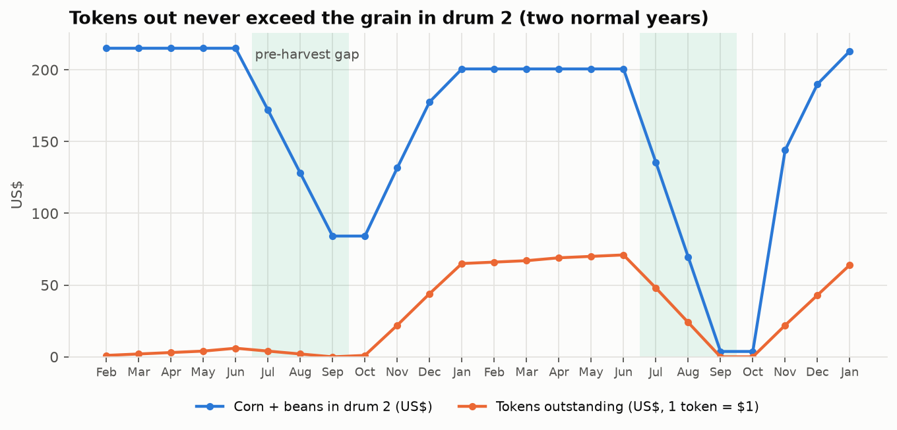
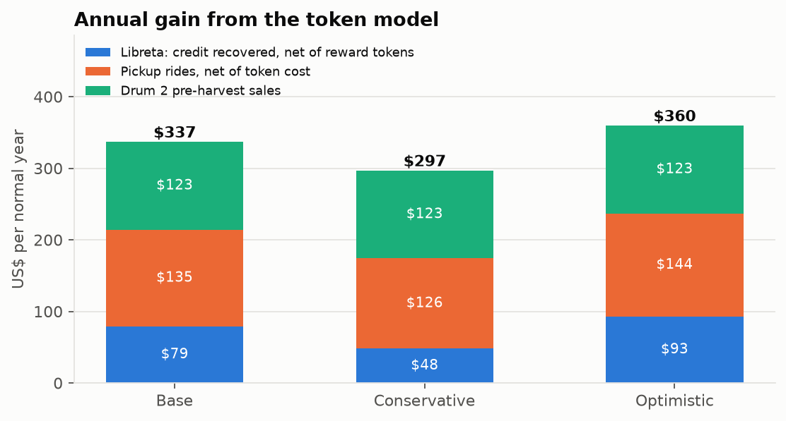

# Milpa Tokens

A closed-loop, grain-backed store voucher for **Tierra Viva Farm**, a fictional
5-acre farm in Toledo District, Belize, from the UNC International Consulting
Fall 2026 case competition. This repo reproduces the final token model in our
pitch deck from the case numbers, and proves its rules hold.

[](https://github.com/momacaes9/milpa-tokens/actions/workflows/ci.yml)

## The idea

Ernestine sells $1,370 a year, $594 of it on credit, and 25% of that credit
($149) is never repaid (Exhibit A). Before harvest she turns away 8-10 buyers a
week for corn and beans (Exhibit D). Tokens are about **corn and beans only**,
with no labor: tokens are never earned for work or hours.

**1 token = BZ$2 = US$1 of Ernestine's corn or beans.** Paper, stamped, numbered
and logged in the **Libreta**, her credit notebook. It is a store voucher, not
money: only Ernestine issues and redeems it. Farmers who bought seed on credit
repay in corn and beans at harvest, and that grain goes into **drum 2**. In the
pre-harvest gap, drum 2 serves token holders and the buyers she turns away
today. **Drum 1 is the family's food** and is never sold.

## Rules

| # | Rule | Source | Enforced in |
|---|---|---|---|
| 1 | 1 token = BZ$2 = US$1 of corn or beans; whole, stamped, numbered tokens | deck; case BZ$2 = US$1 | `Ledger.issue` |
| 2 | Earn: repay credit in corn ($0.30/lb) or beans ($1.00/lb); each $1 of crop = 1 token credited against the debt; grain goes into drum 2 | Exhibit B, deck | `Ledger.repay_in_crops` |
| 3 | Earn: 5% of credit repaid in cash within 30 days, in tokens | deck | `Ledger.repay_cash` |
| 4 | Earn: half the neighbor's pickup fare at peak harvest (12 rides x $10), a transport fare (no labor) | deck | `Ledger.pay_pickup_fare` |
| 5 | Spend: only at her market table, only on corn or beans from drum 2, only in the pre-harvest gap, at case prices | Exhibits B, D; deck | `OutsideWindow`, `NotCornOrBeans` |
| 6 | Tokens outstanding (US$) never exceed the value of corn and beans in drum 2 | deck | `InsufficientBacking` |
| 7 | Drum 1 (family food) is never sold and never backs a token | Exhibit E, deck | `FamilyFoodProtected` |
| 8 | Drum 2 holds at most ~250 lb | Exhibit E | `DrumFull` |
| 9 | Tokens issued in a year are capped at 10% of sales | deck | `CapExceeded` |
| 10 | No transfers between neighbors, no cash-out, no interest | deck | `TransferNotAllowed`, `CashOutNotAllowed` |
| 11 | Every change is atomic; a failed step changes nothing | - | `Ledger.batch` |

Full design: [docs/DESIGN.md](docs/DESIGN.md). Tokens per lb:
[outputs/token_table.md](outputs/token_table.md) (corn 3.33 lb = 1 token,
beans 1 lb = 1 token).

## Lock-in: a token is worth $1 at Tierra Viva and $0 anywhere else

<!-- lock-in -->
| Where the token is used | Value of 1 token | Buys | Why |
|---|---:|---|---|
| Tierra Viva market table: corn | $1.00 | 3.33 lb corn from drum 2 | case price $0.30/lb (Exhibit B); pre-harvest gap, when 8-10 buyers a week are turned away (Exhibit D) |
| Tierra Viva market table: beans | $1.00 | 1.00 lb beans from drum 2 | case price $1.00/lb (Exhibit B); same window |
| Produce truck | $0.00 | nothing | truck sells plantain, tomato, onion, no corn or beans, and does not accept tokens (case, Competition) |
| As cash | $0.00 | nothing | no cash-out: a store voucher, not money |
| Passed to a neighbor | $0.00 | nothing | no transfers: each token is logged to one holder in the Libreta |
<!-- /lock-in -->

## Key numbers

Generated by `milpa build-outputs`; the test suite checks this block against
`outputs/key_results.md`.

<!-- key-results -->
| Result (normal year, base case) | Value | Source |
|---|---|---|
| Tokens issued per year | 73 (13 on-time reward + 60 pickup) | deck |
| Tokens as a share of sales | 5.4% of $1,370 (cap 10% = 137 tokens) | Exhibit A, deck |
| Credit no longer lost | $594 x (25% - 10%) = $89 | Exhibit A, deck |
| Record gain net of reward tokens | $79 | deck |
| Pickup rides gain net of token cost | $135 ($240 - $60 cash - 60 x $1 x 75%) | case cash costs, deck |
| Drum 2 pre-harvest sales | 70% x $176 turned away = $123 | Exhibit D, deck |
| Total of the three gains | $337 (conservative $297, optimistic $360); drums cost $200 once | Exhibit E, deck |
| Corn repaid in kind | 3.33 lb = 1 token | Exhibit B ($0.30/lb) |
| Beans repaid in kind | 1.00 lb = 1 token | Exhibit B ($1.00/lb) |
| Monthly replay (steady state) | 73 tokens issued; lowest drum-2 coverage 2.83 (rule: never below 1.00); drum 1 stays at 250 lb | ledger replay |
<!-- /key-results -->

How the numbers are built (base case; conservative / optimistic in
[outputs/annual_model.md](outputs/annual_model.md)):

* **Reward tokens:** $594 credit x 90% repaid x 50% within 30 days x 5% = 13.
* **Token cost:** each redeemed token costs Ernestine 75% of face (90%
  conservative, 60% optimistic). Record gain = $89 - 13 x $1 x 75% = $79.
* **Unpaid credit with the Libreta:** 10% (15% conservative, 8% optimistic),
  down from 25% today.
* **Pickup:** today $240 a year of rides; with a neighbor's pickup, 12 rides x $10,
  $60 in cash and 60 tokens.
* **Drum 2:** 9 buyers a week x 13 weeks x $1.50 = $176 turned away; drum 2 serves 70%.




All outputs (Markdown, CSV, PNG) are in [`outputs/`](outputs/): key results,
annual model in three cases, lock-in table, tokens per lb, the monthly replay
through the Libreta rules, and three charts.

## Sources

* **Case packet (Exhibits A-E), kept exactly:** normal-year sales $1,370, credit
  $594, 25% never repaid ($149) (A); corn $0.30/lb, beans $1.00/lb (B); $240 a year
  of pickup rides (case cash costs); 8-10 buyers a week turned away for 13 weeks
  at about $1.50 (D); drums $100 each holding ~250 lb (E); BZ$2 = US$1.
* **Pitch deck:** the token definition, the three ways to earn, the 5% reward,
  75% / 90% / 60% token cost, 10% / 15% / 8% unpaid credit with the Libreta,
  the 10% cap, 12 rides x $10 with half in tokens, and 70% of turned-away buyers
  served from drum 2.
* **Assumptions** (each labelled in `config/tierra_viva.json` under
  `assumptions`): 50% of repaid credit comes back within 30 days (reproduces the
  deck); drum 2 holds 50 lb corn + 200 lb beans; five farmers repay 50 lb corn
  + 100 lb beans in kind; harvest Nov-Jan and the gap Jul-Sep.
* Background research (Belize prices, community-currency evidence) is in
  [docs/RESEARCH.md](docs/RESEARCH.md) and
  [data/belize_reference_data.csv](data/belize_reference_data.csv).

## Limits

* **Normal year only.** The deck's numbers are for a normal year. A bad year
  ($900 sales, 40% unpaid) is not modelled because the deck gives no Libreta
  effect for it.
* **The Libreta effect is an estimate.** 25% to 10% unpaid is the deck's
  assumption, not a measured result; the conservative case (15%) shows the
  downside.
* **Drum 2 is tight.** Tokens plus pre-harvest sales need about $196 of grain
  in the gap; a 250-lb drum holds $215 only if it is mostly beans. If drum 2
  holds less, the code refuses sales before it lets a token go unbacked.
* **No seasonal price swing.** Tokens are spent at case prices; no Toledo
  harvest vs. pre-harvest price series was found.
* **The 15 owing households are one account in the replay** so reward cents add
  up as the deck counts them; per-household rules are unit-tested.

## Run

```bash
pip install -e .            # core: no dependencies, Python 3.10+
milpa check                 # config reconciles with Exhibit A and the token rules
milpa model                 # annual gains: base, conservative, optimistic
milpa lockin                # $1 at Tierra Viva, $0 at the truck, $0 as cash
milpa token-table           # tokens per lb of corn and beans
milpa simulate              # monthly replay through the Libreta rules
pip install -e '.[charts]'  # matplotlib, only for PNG charts
milpa build-outputs         # regenerate everything in outputs/
python -m unittest discover -s tests
```
