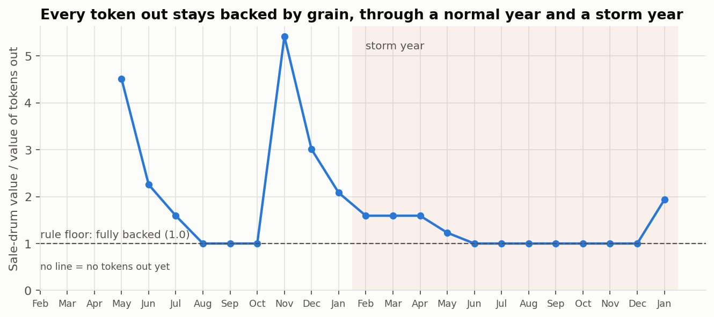
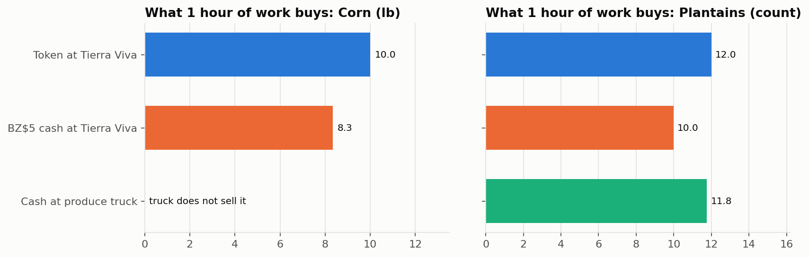

# Milpa Tokens

A closed-loop, food-backed harvest credit for **Tierra Viva Farm**, a fictional
5-acre farm in Toledo District, Belize, from the UNC International Consulting
Fall 2026 case competition.

[](https://github.com/momacaes9/milpa-tokens/actions/workflows/ci.yml)

## The idea

Ernestine has no cash to pay for help at planting and harvest, loses $149 a year
(normal year; $196 in a bad one) to credit that is never repaid, and turns away
8-10 buyers a week for corn and beans before harvest. A **Milpa Token** is a paper
slip for **one hour of work** at Tierra Viva. She pays neighbors' hours with
tokens; months later, when the village is short of food, the neighbor brings the
token back for **10 lb of corn** (or the same $3.00 value in beans, seed, or fresh
produce that would otherwise spoil) from her **sale drums**. Old debts can be
**paid in hands**: an hour of work cancels US$2.50 of an unpaid balance, the
Belize minimum wage. The token buys 20% more food than the hour's cash wage,
which is why a neighbor prefers it.

> **Tokens are not money.** Only Ernestine issues them and only Ernestine redeems
> them, for food only. They cannot be passed between neighbors, are never cashed
> out, and earn no interest. **The family's food for six people is never part of
> the token reserve.** Ernestine runs everything on paper (a notebook, numbered
> paper tokens, WhatsApp voice notes); this code exists only to prove the rules
> hold and to simulate outcomes from the case numbers.

## Rules

| # | Rule | Enforced in |
|---|---|---|
| 1 | 1 token = 1 hour of work, whole hours only | `Ledger.issue` |
| 2 | Issued only in planting (May, Jun, Dec) and harvest months | `OutsideWindow` |
| 3 | Issued only while sale drums cover every token out (coverage >= 1.0) | `InsufficientBacking` |
| 4 | Family drum never counts as reserve and can never be drawn | `FamilyFoodProtected` |
| 5 | Max 10 tokens held per household | `CapExceeded` |
| 6 | Tokens expire 12 months after issue | `Ledger.expire` |
| 7 | Redeemed only in windows: grain pre-harvest/storm months, seed before planting, fresh produce at harvest | `OutsideWindow` |
| 8 | No transfers, no cash-out, no interest | `TransferNotAllowed`, `CashOutNotAllowed` |
| 9 | Every change is atomic; a failed step changes nothing | `Ledger.batch` |
| 10 | A grain token may be paid as a corn-and-beans mix of the same value | `Ledger.redeem_grain_mix` |

Full design: [docs/DESIGN.md](docs/DESIGN.md).

## What one token is worth

Prices are Ernestine's own (case Exhibit B). The wage peg is the Belize national
minimum wage, BZ$5.00/h = US$2.50, in force since 1 January 2023.

| Item | One token redeems for | Retail value | One hour's cash wage buys |
|---|---|---|---|
| Corn (dried) | 10 lb | $3.00 | 8.3 lb |
| Beans (dried) | 3 lb | $3.00 | 2.5 lb |
| Seed corn | 3 lb | $3.00 | 2.5 lb |
| Plantains (harvest surplus) | 12 | $3.00 | 10 |
| Peppers / tomatoes / herbs (harvest surplus) | 2 lb | $3.00 | 1.7 lb |

Redemption months: [docs/TOKEN_TABLE.md](docs/TOKEN_TABLE.md).

## Lock-in: why hold a token instead of cash

| Item | 1 token buys at Tierra Viva | 1 hour's cash wage (BZ$5.00 = US$2.50) buys at Tierra Viva | ...at the produce truck (10-15% cheaper) | ...at Punta Gorda market* | Token vs cash at Tierra Viva | Token vs truck (truck's best price) | Can cash buy it from her pre-harvest? |
|---|---|---|---|---|---|---|---|
| Corn (dried) | 10.0 lb | 8.3 lb | not sold | 11.1 lb (2022-08-13) | +20% | n/a | not today: 8-10 buyers a week turned away |
| Beans (dried) | 3.0 lb | 2.5 lb | not sold | 2.5 lb (2022-08-13) | +20% | n/a | not today: 8-10 buyers a week turned away |
| Seed corn | 3.0 lb | 2.5 lb | not sold | n/a | +20% | n/a | yes |
| Plantains | 12.0 | 10.0 | 11.1-11.8 | 15.2 (2022-08-13) | +20% | +2% | yes |
| Peppers / tomatoes / herbs | 2.0 lb | 1.7 lb | 1.9-2.0 | 1.4 lb (2022-08-13) | +20% | +2% | yes |

\* BAPIS retail prices, latest Punta Gorda report reachable (2022). Reaching the market costs a $5 round-trip bus fare (Exhibit D), two hours of wage, so it is not a practical option for one hour's pay.

## Key results

Generated by `milpa build-outputs` (this block is checked against
`outputs/key_results.md` by the test suite):

<!-- key-results -->
| Result | Value |
|---|---|
| Food one token buys vs one hour's cash wage at Tierra Viva | 10 lb vs 8.3 lb corn (+20%) |
| Token vs produce truck's best plantain price | +2% |
| Lock-in if the in-kind rate drops to 9 lb | +8% vs cash; -8% vs truck |
| Lock-in if the wage peg rises to BZ$6 | +0% vs cash; -15% vs truck |
| Helper hours a normal year (tokens + debt paid in hands) | 78 h, 47 h of them at harvest |
| Never-repaid credit recovered as labor, normal year | 17.8 h = $45 of the $149 lost today |
| Helper hours, bad-weather year | 65 h (23.6 h from old debt) |
| Tokens issued / redeemed, normal year | 60 / 34 (rest outstanding, backed) |
| Value redeemed in produce that would have spoiled | $36 |
| Lowest coverage of tokens by sale drums | 1.00 normal / 1.00 bad / 1.00 normal-then-storm (rule: never below 1.00) |
| Tokens expired over a normal year followed by a storm year | 4 |
| In-kind rate needed to keep the same premium if the wage rises to BZ$6 | 12 lb corn per token |
<!-- /key-results -->

### Simulation, normal and bad-weather year

| | Today (case) | Drums only | Drums + Milpa Tokens |
|---|---:|---:|---:|
| Cash collected, normal year | $1,222 | $1,362 | $1,300 |
| Cash collected, bad year | $704 | $764 | $704 |
| Helper hours, normal / bad year | 0 / 0 | 0 / 0 | 78 / 65 |
| Lowest coverage of tokens by sale drums | - | - | 1.00 |

Read this honestly: with **2 drums**, tokens trade about $62 of pre-harvest grain
sales for 78 hours of help and $45 of old debt repaid in work. With **3 drums**
the cash cost disappears (see `outputs/sensitivity.md`), but three drums cost
$300 of her $350 savings. Never-repaid credit itself is unchanged: tokens convert
part of it to labor rather than to cash.

All outputs (Markdown, CSV, PNG) for the pitch deck are in [`outputs/`](outputs/):
lock-in table, token table, season simulation (summary and monthly), a two-year
normal-then-storm stress test, Monte Carlo (2,000 runs, seed 2026), sensitivity
(BZ$5 vs BZ$6, 10 vs 9 lb, 2 vs 3 drums) and five charts.




## Sources

Case numbers come from the case packet (Exhibits A-F) and are kept exactly:
2026 normal-year sales $1,370, 43% on credit, 25% never repaid ($149); bad year
$900, 55%, 40% ($196); corn $0.30/lb, beans $1.00/lb, seed $1.00/lb; drums $100
each holding ~250 lb; $350 savings; BZ$2 = US$1.

External figures (minimum wage, BZ$6 status, BAPIS and SIB prices, Toledo
planting calendar, Sarafu RCT and 2025 survey, Banco Palmas, time banks) are in
[`data/belize_reference_data.csv`](data/belize_reference_data.csv) with URL and
date, summarised in [docs/RESEARCH.md](docs/RESEARCH.md).

## Limits

* **Assumptions are labelled, not hidden.** Harvest-month placement, drum mix,
  bad-year drum fill, help wanted (16 h per work month), the share of bad debt
  repaid in hands (30%) and the redemption rate (90%) are assumptions; each one is
  listed in `config/tierra_viva.json` under `assumptions`. The Monte Carlo varies
  the repayment-related ones.
* **No seasonal price swing.** No Toledo harvest vs. pre-harvest price series was
  found, so the model uses the case's turned-away demand, not a price premium.
* **Wage peg.** BZ$6 is announced, not enacted (as of 19 Nov 2026). At BZ$6 the
  in-kind rate must rise to 12 lb of corn to keep the same lock-in.
* **Punta Gorda.** At 2022 Punta Gorda retail prices, an hour's cash buys 11.1 lb
  of corn, more than a token, but getting there costs a $5 bus fare.
* **Not modelled:** seed redemptions (no seed stock figure in the case), labor
  quality, social dynamics of who joins. The family drum (250 lb) shows the family
  reserve is never touched; it is not a claim that 250 lb feeds six people for a year.

## Run

```bash
pip install -e .            # core: no dependencies, Python 3.10+
milpa check                 # config reconciles with Exhibit A
milpa lockin                # lock-in table (try --wage-bzd 6 --in-kind-lb 12)
milpa simulate              # both years, three scenarios
milpa simulate --monte-carlo 2000 --seed 2026
milpa sensitivity
pip install -e '.[charts]'  # matplotlib, only for PNG charts
milpa build-outputs         # regenerate everything in outputs/
python -m unittest discover -s tests
```
